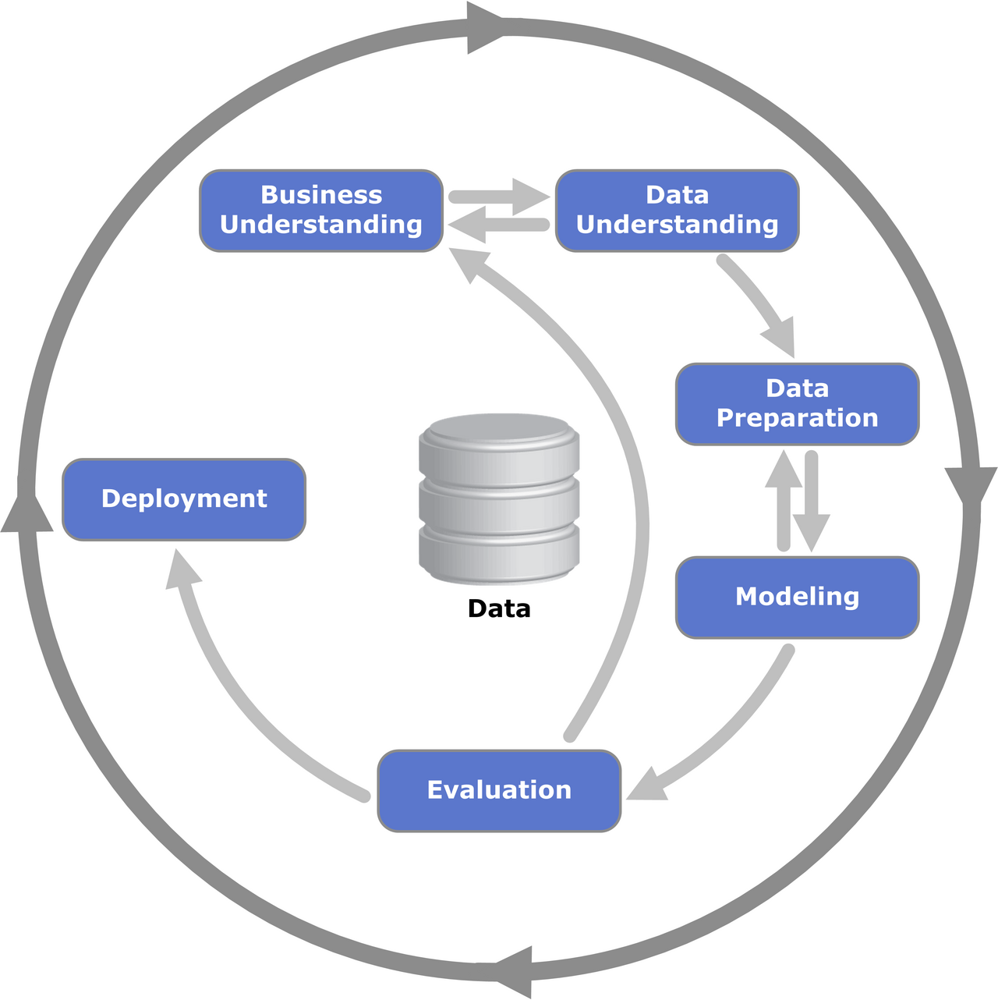

# Introdução {.unnumbered}

```{r}
#| echo: false
#| include: false
```

Este livro apresenta aplicações práticas de ciência de dados inspiradas em casos reais, vistas sob a ótica de negócios. Em cada capítulo, partimos de um problema que uma empresa poderia enfrentar (prever a falha de uma máquina, precificar um imóvel, entender o perfil dos clientes, definir ações de venda cruzada) e mostramos, passo a passo, como os dados podem ajudar a resolvê-lo.

O foco não está em apresentar uma técnica isolada, mas em mostrar **como ela se encaixa em um projeto de ponta a ponta**: da pergunta de negócio até o uso prático dos resultados.

[Última atualização: `r format(Sys.Date(), "%d/%m/%Y")`.]

## O processo que guia as análises: CRISP-DM

Projetos de ciência de dados bem-sucedidos raramente começam pelo algoritmo. Para organizar o trabalho, usamos ao longo do livro o **CRISP-DM** (*Cross-Industry Standard Process for Data Mining*), um processo criado no fim da década de 1990 por um consórcio de empresas e instituições europeias e que se tornou um dos referenciais mais usados em projetos de análise de dados [@chapman2000crispdm; @wirth2000crispdm]. Ele é neutro em relação a setor, ferramenta e técnica, o que o torna adequado para casos tão distintos quanto os deste livro.

O CRISP-DM divide um projeto em seis fases:

1. **Entendimento do negócio** (*business understanding*): definir o problema, os objetivos e os critérios de sucesso do ponto de vista do negócio, antes de olhar para os dados.
2. **Entendimento dos dados** (*data understanding*): coletar os dados disponíveis, descrevê-los, explorá-los e avaliar sua qualidade.
3. **Preparação dos dados** (*data preparation*): selecionar, limpar, transformar e integrar os dados, até chegar à base que será usada na modelagem.
4. **Modelagem** (*modeling*): escolher e aplicar técnicas estatísticas ou de aprendizado de máquina, ajustando seus parâmetros.
5. **Avaliação** (*evaluation*): verificar se os resultados são consistentes e, principalmente, se respondem ao objetivo de negócio definido no início.
6. **Implantação** (*deployment*): colocar os resultados em uso (um relatório, uma regra de decisão, um modelo em produção) e planejar seu monitoramento e manutenção.

{#fig-crispdm width="70%" fig-alt="Diagrama circular do CRISP-DM, com as fases Entendimento do negócio, Entendimento dos dados, Preparação dos dados, Modelagem, Avaliação e Implantação, ao redor dos dados."}

Como mostra o diagrama (@fig-crispdm), o processo **não é uma sequência rígida**. As setas indicam as dependências mais frequentes entre as fases, mas é comum voltar atrás: uma avaliação ruim pode levar a uma nova preparação dos dados, e o entendimento dos dados pode obrigar a rever o problema de negócio. O círculo externo lembra que o trabalho continua depois da implantação, pois os modelos precisam ser monitorados e atualizados.

::: {.callout-note title="Como o CRISP-DM aparece neste livro"}
Sempre que possível, os capítulos seguem a lógica do CRISP-DM: começam pelo problema de negócio, passam pela exploração e preparação dos dados, apresentam a modelagem e a avaliação e terminam discutindo o uso prático e as limitações dos resultados. Nem todos os capítulos enfatizam todas as fases. Em alguns, o destaque é a exploração dos dados, em outros a modelagem ou a interpretação dos resultados para o negócio.
:::

## O que você vai encontrar

Os capítulos são estudos de caso **inspirados em situações reais**. Eles usam bases de dados públicas ou simuladas, e cada capítulo indica a origem dos dados e suas limitações. Os resultados, portanto, ilustram o uso das técnicas e não devem ser tomados como conclusões sobre os mercados ou setores retratados.

<!-- | Capítulo | Tema | Tipo de análise | Linguagem | -->
<!-- |:--|:--|:--|:--| -->
<!-- | 1 | Atrasos em voos | Análise descritiva | R | -->
<!-- | 2 | Manutenção preditiva | Classificação | Python | -->
<!-- | 3 | Aluguel de apartamentos | Regressão | R | -->
<!-- | 4 | Consumo de bebidas alcoólicas | Agrupamento | R | -->
<!-- | 5 | Clientes de um mercado | Agrupamento | Python | -->
<!-- | 6 | Estratégias de cross-selling | Regras de associação | R | -->

## Código em R e em Python

Todas as análises são acompanhadas do **código completo**, que pode ser copiado e executado. Ele aparece ora em **R**, ora em **Python**, justamente para mostrar como os mesmos conceitos e etapas do processo se aplicam nas duas linguagens, que são as mais usadas em ciência de dados. A escolha em cada capítulo busca apenas variar os exemplos. As técnicas apresentadas podem ser reproduzidas em qualquer uma das duas.

Este material não é um curso de programação. Alguma familiaridade com R ou Python ajuda a acompanhar o código, mas a narrativa de cada capítulo foi escrita para ser compreendida também por quem quer focar no raciocínio analítico e nas decisões de negócio.

## Dados e códigos {#sec-dados}

Os códigos-fonte deste livro estão disponíveis no [repositório do projeto no GitHub](https://github.com/magnotairone/aplicacoes), e as bases de dados utilizadas nos capítulos estão reunidas nesta [pasta pública](https://tinyurl.com/3f8ez3hz).

Para reproduzir as análises, baixe os arquivos da pasta e salve-os em um diretório chamado `data`, no mesmo local em que estiver o código. Os códigos leem os arquivos a partir desse diretório (por exemplo, `data/sao-paulo-properties-april-2019.csv`).

<!-- ## Referências desta introdução -->

<!-- O CRISP-DM é descrito em detalhe no guia original [@chapman2000crispdm]. Para uma leitura voltada a gestores e profissionais de negócio, que usa o mesmo raciocínio de ligar problema de negócio, dados e decisão, veja @provost2013data. -->
