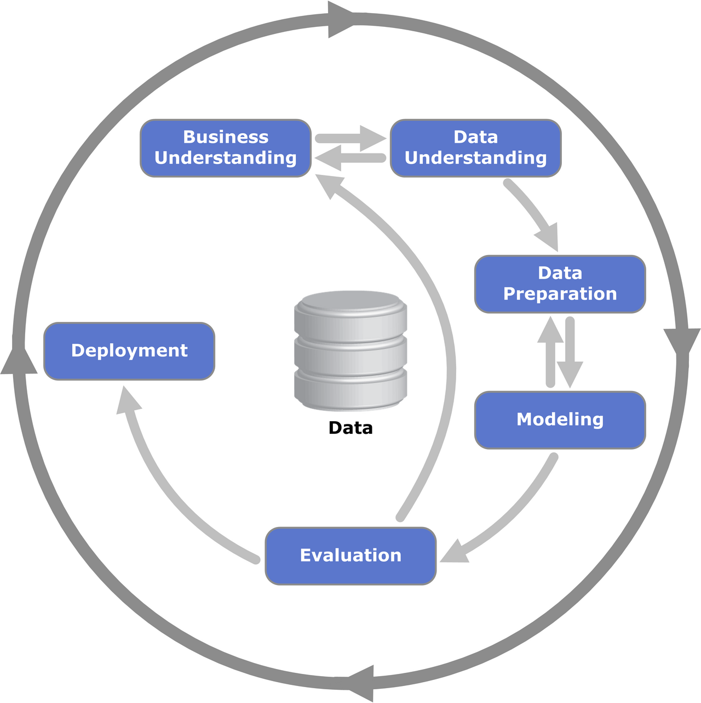

# Introdução {.unnumbered}

```{r}
#| echo: false
#| include: false
```

{.capa-livro fig-alt="Capa do livro Ciência de Dados Aplicada, de Magno Severino: no canto inferior esquerdo, uma explosão caótica de pontos e traços coloridos que, rumo ao canto superior direito, se organiza em linhas paralelas e em quatro grupos circulares de pontos."}

Este livro apresenta aplicações práticas de ciência de dados inspiradas em casos reais, vistas sob a ótica de negócios. Em cada capítulo, partimos de um problema que uma empresa poderia enfrentar (prever a falha de uma máquina, precificar um imóvel, entender o perfil dos clientes, definir ações de venda cruzada) e mostramos, passo a passo, como os dados podem ajudar a resolvê-lo.

O foco não está em apresentar uma técnica isolada, mas em mostrar **como ela se encaixa em um projeto de ponta a ponta**: da pergunta de negócio até o uso prático dos resultados.

Não é preciso saber programar para acompanhar o livro. Os capítulos trazem trechos de código em R e em Python, que reproduzem cada etapa das análises. Esses trechos são **totalmente opcionais**: o texto explica cada passo e interpreta cada resultado, de modo que o livro pode ser lido do começo ao fim sem nenhum conhecimento de linguagens de programação. Quem quiser reproduzir ou adaptar as análises encontra o código completo junto ao texto.

[Última atualização: [—]{#data-atualizacao}.]

## O processo que guia as análises: CRISP-DM

Projetos de ciência de dados bem-sucedidos raramente começam pelo algoritmo. Para organizar o trabalho, usamos ao longo do livro o **CRISP-DM** (*Cross-Industry Standard Process for Data Mining*), um processo criado no fim da década de 1990 por um consórcio de empresas e instituições europeias e que se tornou um dos referenciais mais usados em projetos de análise de dados [@chapman2000crispdm; @wirth2000crispdm]. Ele é neutro em relação a setor, ferramenta e técnica, o que o torna adequado para casos tão distintos quanto os deste livro.

O CRISP-DM divide um projeto em seis fases:

1. **Entendimento do negócio** (*business understanding*): definir o problema, os objetivos e os critérios de sucesso do ponto de vista do negócio, antes de olhar para os dados.
2. **Entendimento dos dados** (*data understanding*): coletar os dados disponíveis, descrevê-los, explorá-los e avaliar sua qualidade.
3. **Preparação dos dados** (*data preparation*): selecionar, limpar, transformar e integrar os dados, até chegar à base que será usada na modelagem.
4. **Modelagem** (*modeling*): escolher e aplicar técnicas estatísticas ou de aprendizado de máquina, ajustando seus parâmetros.
5. **Avaliação** (*evaluation*): verificar se os resultados são consistentes e, principalmente, se respondem ao objetivo de negócio definido no início.
6. **Implantação** (*deployment*): colocar os resultados em uso (um relatório, uma regra de decisão, um modelo em produção) e planejar seu monitoramento e manutenção.

{#fig-crispdm width="70%" fig-alt="Diagrama circular do CRISP-DM, com as fases Entendimento do negócio, Entendimento dos dados, Preparação dos dados, Modelagem, Avaliação e Implantação, ao redor dos dados."}

Como mostra o diagrama (@fig-crispdm), o processo **não é uma sequência rígida**. As setas indicam as dependências mais frequentes entre as fases, mas é comum voltar atrás: uma avaliação ruim pode levar a uma nova preparação dos dados, e o entendimento dos dados pode obrigar a rever o problema de negócio. O círculo externo lembra que o trabalho continua depois da implantação, pois os modelos precisam ser monitorados e atualizados.

::: {.callout-note title="Como o CRISP-DM aparece neste livro"}
Sempre que possível, os capítulos seguem a lógica do CRISP-DM: começam pelo problema de negócio, passam pela exploração e preparação dos dados, apresentam a modelagem e a avaliação e terminam discutindo o uso prático e as limitações dos resultados. Nem todos os capítulos enfatizam todas as fases. Em alguns, o destaque é a exploração dos dados, em outros a modelagem ou a interpretação dos resultados para o negócio.
:::

## O que você vai encontrar

Os capítulos são estudos de caso **inspirados em situações reais**. Eles usam bases de dados públicas ou simuladas, e cada capítulo indica a origem dos dados e suas limitações. Os resultados, portanto, ilustram o uso das técnicas e não devem ser tomados como conclusões sobre os mercados ou setores retratados.

A maior parte dos casos usa técnicas de **aprendizado de máquina**, que costumam ser divididas em dois grandes grupos, conforme o tipo de pergunta que se quer responder.

- No **aprendizado supervisionado**, existe uma variável que queremos prever (a falha de uma máquina, o valor de um aluguel) e um histórico em que essa variável já é conhecida. O modelo aprende com esses exemplos e depois é usado para prever casos novos. Como a resposta certa é conhecida no histórico, é possível medir com precisão quanto o modelo erra.
- No **aprendizado não supervisionado**, não há uma resposta a prever. O objetivo é descobrir estrutura nos próprios dados, como grupos de clientes parecidos entre si ou produtos que costumam ser comprados juntos. Sem um gabarito, a qualidade do resultado é julgada sobretudo pela sua coerência e pela sua utilidade para o negócio.

Antes desses dois blocos, o livro começa pela análise descritiva, base de qualquer projeto, e termina com um caso de modelos de linguagem, que combina várias dessas ideias.

### Ponto de partida

- [**Atrasos em voos**](01_analise_descritiva.qmd) (análise descritiva, em R). Com dados dos voos que partiram de Nova York em 2013, o capítulo apresenta os tipos de variáveis, as medidas de posição e de dispersão e os principais gráficos, e depois os usa para responder perguntas de negócio, como quais rotas e companhias concentram os maiores atrasos e qual o papel das condições meteorológicas.

### Aprendizado supervisionado

- [**Manutenção preditiva**](02_classificacao_manutencao_preventiva.qmd) (classificação, em Python). Uma indústria quer saber quais equipamentos inspecionar antes que quebrem. A partir de sensores como temperatura, rotação, torque e desgaste da ferramenta, modelos de classificação estimam a probabilidade de falha. Como uma quebra custa muito mais do que uma inspeção, o capítulo transforma essa probabilidade em uma regra de decisão, escolhendo o limiar que minimiza o custo total.
- [**Aluguel de apartamentos em São Paulo**](03_regressao.qmd) (regressão, em R). Uma imobiliária precisa sugerir o valor do aluguel de um imóvel recém-anunciado. Com cerca de 13,6 mil anúncios, o capítulo compara regressão linear, árvore de decisão e floresta aleatória, mede o erro de previsão em dados nunca vistos pelo modelo e mostra quais características (metragem, condomínio, localização) mais pesam no preço.
- [**Um modelo otimizado para sugerir o aluguel**](03a_anexo_regressao.qmd) (regressão, em R). Um anexo ao caso anterior que leva o modelo para mais perto do uso em produção: inclui o bairro como variável, modela o logaritmo do preço, ajusta hiperparâmetros por validação cruzada comparando floresta aleatória e XGBoost e termina com uma função que sugere uma faixa de aluguel para um imóvel novo.

### Aprendizado não supervisionado

- [**Segmentação de mercados de bebidas no mundo**](04_cluster_538.qmd) (agrupamento, em R). Uma multinacional de bebidas quer organizar sua estratégia internacional em poucos grupos de países. Com dados da Organização Mundial da Saúde sobre o consumo de cerveja, vinho e destilados em cerca de 190 países, o capítulo apresenta o algoritmo k-médias e mostra que a escolha das variáveis é uma decisão de negócio: agrupar pelo volume consumido indica onde o hábito é forte, e agrupar pelo mix de bebidas indica o que vender. Dados de população e renda do Banco Mundial completam a análise com o tamanho de cada mercado.
- [**Segmentação de clientes de um mercado**](05_cluster_pda.qmd) (agrupamento, em Python). Um gestor de marketing quer parar de tratar todos os clientes da mesma forma. A partir de dados de perfil, de crédito e de comportamento de compra, o k-médias identifica segmentos como clientes de alto valor e clientes pouco ativos, estima quanto vale cada grupo e discute a diferença entre o número de grupos sugerido pela estatística e o mais útil para o negócio.
- [**Venda cruzada em supermercado**](06_groceries.qmd) (regras de associação, em R). Um gerente de categoria precisa decidir quais produtos colocar em promoção conjunta ou lado a lado na gôndola. O algoritmo *apriori* encontra regras do tipo "quem compra X também compra Y", e o capítulo mostra como separar, entre milhares de regras, as que têm evidência suficiente e alcance comercial relevante.

### Modelos de linguagem

- [**Conversando com seus documentos**](07_rag.qmd) (RAG, em Python). Um assistente que responde perguntas com base em um documento e indica a página de onde tirou cada informação. O capítulo explica, com exemplos pequenos, a tokenização e os embeddings, constrói o assistente com a técnica de geração aumentada por recuperação (RAG) sobre o manual de um pacote de gráficos e avalia a taxa de acerto da busca e a qualidade das respostas, além de discutir custos e segurança. Ele não se encaixa bem na divisão anterior: os modelos de linguagem são treinados em enormes volumes de texto sem rótulos, mas aqui são usados para responder perguntas sobre um conteúdo específico.

| Caso | Tipo de aprendizado | Técnica | Linguagem |
|:--|:--|:--|:--|
| Atrasos em voos | — | Análise descritiva | R |
| Manutenção preditiva | Supervisionado | Classificação | Python |
| Aluguel de apartamentos | Supervisionado | Regressão | R |
| Modelo otimizado de aluguel | Supervisionado | Regressão | R |
| Mercados de bebidas | Não supervisionado | Agrupamento | R |
| Clientes de um mercado | Não supervisionado | Agrupamento | Python |
| Venda cruzada | Não supervisionado | Regras de associação | R |
| Assistente para documentos | Modelos de linguagem | RAG | Python |

: Resumo dos estudos de caso do livro. {#tbl-casos}

## Código em R e em Python

Todas as análises são acompanhadas do **código completo**, que pode ser copiado e executado. Ele aparece ora em **R**, ora em **Python**, justamente para mostrar como os mesmos conceitos e etapas do processo se aplicam nas duas linguagens, que são as mais usadas em ciência de dados. A escolha em cada capítulo busca apenas variar os exemplos. As técnicas apresentadas podem ser reproduzidas em qualquer uma das duas.

Este material não é um curso de programação. Alguma familiaridade com R ou Python ajuda a acompanhar o código, mas a narrativa de cada capítulo foi escrita para ser compreendida também por quem quer focar no raciocínio analítico e nas decisões de negócio.

## Dados e códigos {#sec-dados}

Os códigos-fonte deste livro estão disponíveis no [repositório do projeto no GitHub](https://github.com/magnotairone/aplicacoes), e as bases de dados utilizadas nos capítulos estão reunidas nesta [pasta pública](https://tinyurl.com/3f8ez3hz).

Para reproduzir as análises, baixe os arquivos da pasta e salve-os em um diretório chamado `data`, no mesmo local em que estiver o código. Os códigos leem os arquivos a partir desse diretório (por exemplo, `data/sao-paulo-properties-april-2019.csv`).

<!-- ## Referências desta introdução -->

<!-- O CRISP-DM é descrito em detalhe no guia original [@chapman2000crispdm]. Para uma leitura voltada a gestores e profissionais de negócio, que usa o mesmo raciocínio de ligar problema de negócio, dados e decisão, veja @provost2013data. -->
